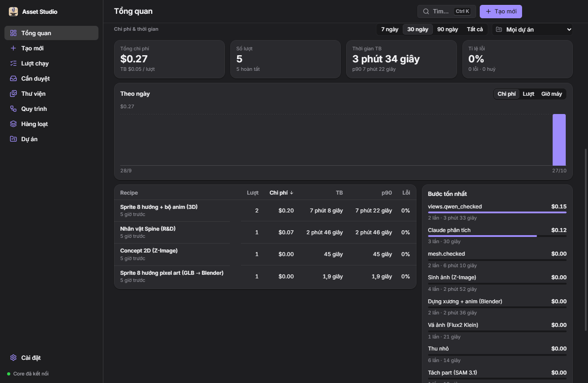

# AI Asset Studio

App Windows tạo asset game bằng AI, chạy ngay trên máy: gõ mô tả → chọn ảnh ưng → nhận sprite, texture, tileset,
model 3D, nhân vật Spine, rồi xuất thẳng cho engine.

## Tải về

Bản mới nhất: **[v1.4.0](https://github.com/doanvu2000/AI-Asset-Studio/releases/latest)** (Windows x64)

| File | Dùng khi |
|------|----------|
| `AI-Asset-Studio-Portable-1.4.0-x64.zip` | Giải nén ra đâu cũng chạy, dữ liệu nằm trong thư mục `data\` (khuyên dùng) |
| `AI-Asset-Studio-Setup-1.4.0-x64.exe` | Cài vào máy, có shortcut Start menu / Desktop |

## Tính năng chính

**Quy trình 2D / sprite**
- Concept 2D nền trong, biến thể, vẽ theo style tham chiếu
- Texture và tileset liền mạch (Wang, autotile), pixel art tự chọn số màu
- Normal map: bộ lọc hoặc AI (MoGe-2, chạy CPU), cài trong **Cài đặt**
- Sprite 8 hướng và hoạt ảnh (đứng / đi / chạy / đánh), ổn định chân, bóng đổ
- Nhân vật Spine có xương, hoạt ảnh và skin đổi màu
- VFX flipbook, thời tiết lặp, UI kit, thẻ bài, bộ icon, parallax

**3D**
- Prop 3D (TRELLIS) và Procedural 3D (Claude viết code Blender), bước game-ready: LOD, bake normal + AO
- Prop phá huỷ được, địa hình, skybox 360

**Xuất cho engine**
- **Flutter / Flame (đích mặc định)**: sprite, tile + `.tmx`, VFX, UI, Shader Pack, demo chạy được bằng `flutter run`
- **Android Compose** và **iOS SwiftUI**: sprite, UI, tile động, autotile, VFX, thời tiết, màn UI, minimap, thẻ bài
- **Theme UI** từ style bible (sáng / tối, WCAG AA) cho Flutter, Compose, SwiftUI
- **Tự xuất khi duyệt**: bản được duyệt tự chép vào thư mục game của dự án
- **Unity**, **Godot 4**, Spine, GLB

**Khác**
- Đèn hợp máy đỏ / vàng / xanh: app dò GPU, RAM, ổ đĩa và báo quy trình / model nào chạy được
- Flow và GDD: Claude lập kế hoạch asset từ GDD, lưu lịch sử kế hoạch
- MCP: Claude Code / Codex điều khiển app qua MCP, skill và plugin
- Thư viện theo dự án, bộ lọc Gallery một hàng, thử lại từng bước
- Chạy lại giữ hoặc đổi seed; lưu thiết lập chạy; 1 prompt × N seed; tự chọn ảnh QA cao nhất
- Flow editor: xoá, hoàn tác / làm lại (50 bước)

## Yêu cầu máy

- Windows 10/11 x64, GPU NVIDIA ≥ 12 GB VRAM (driver ≥ 580), khuyên RAM 64 GB
- Ổ trống ~140 GB nếu lấy đủ model (nên SSD)
- Internet cho lần cài đầu; tài khoản Claude cho các bước Claude

## Cài đặt

- **Portable**: giải nén zip, chạy `AI Asset Studio Portable\AI Asset Studio.exe`
- **Setup**: chạy file `.exe`, dữ liệu ở `%APPDATA%\AI Asset Studio\data`
- SmartScreen báo cảnh báo → **More info → Run anyway** (app chưa ký số)
- Mở app → thẻ **Bắt đầu** → **Cài tự động**: chọn thư mục, chọn gói model, **Cài tất cả**, rồi **Đăng nhập Claude**
- Đứt mạng giữa chừng: mở lại, bấm **Cài tiếp**
- Đã có ComfyUI sẵn: **Cài đặt → Đường dẫn công cụ** → chọn từng dòng → **Kiểm tra lại**

| Gói model | Dung lượng | Dùng cho |
|-----------|-----------:|----------|
| Cơ bản 2D (bắt buộc) | 22.6 GB | Concept 2D, texture, tileset, tách nền |
| Biến thể + Spine | 5.7 GB | Biến thể 2D, nhân vật Spine |
| Nhiều góc nhìn | 29.1 GB | Sprite 8 hướng, hoạt ảnh |
| 3D | 19 GB | Prop 3D, sprite qua mesh |
| Âm thanh | ~15.8 GB | SFX, nhạc nền lặp |
| Hiệu ứng VFX | ~22.5 GB | VFX flipbook, cần ~64 GB RAM |

## Dùng lần đầu

- **Tạo mới** (`Ctrl+N`) → chọn quy trình → gõ prompt tiếng Anh → **Bắt đầu chạy**
- Bước **Thủ công** dừng chờ bạn chọn ảnh (mục **Cần duyệt**)
- Xong → **Đưa vào thư viện** hoặc **Xuất cho engine**
- Làm game Flutter: tạo **dự án**, chọn engine đích **Flutter**, bật **Tự xuất khi duyệt** và chọn thư mục game; duyệt xong file tự vào đó
- Phím tắt: `Ctrl+Enter` chạy / quét, `Ctrl+K` tìm nhanh
- Lỗi: **Cài đặt → Nhật ký chẩn đoán → Copy** để gửi log

## Chạy từ mã nguồn

- Xem [BUILD.md](BUILD.md), có cách chạy test nhanh song song (~60 giây)

## Cảm ơn

- Font **Be Vietnam Pro** và **JetBrains Mono** (SIL OFL)
- Model chính: Z-Image, Flux.2 Klein, Qwen-Image, TRELLIS, Wan 2.1 / 2.2, Stable Audio Open, ACE-Step 1.5
- Chạy trên ComfyUI, Blender, Spine runtime format; Claude Code / Codex cho các bước agent
