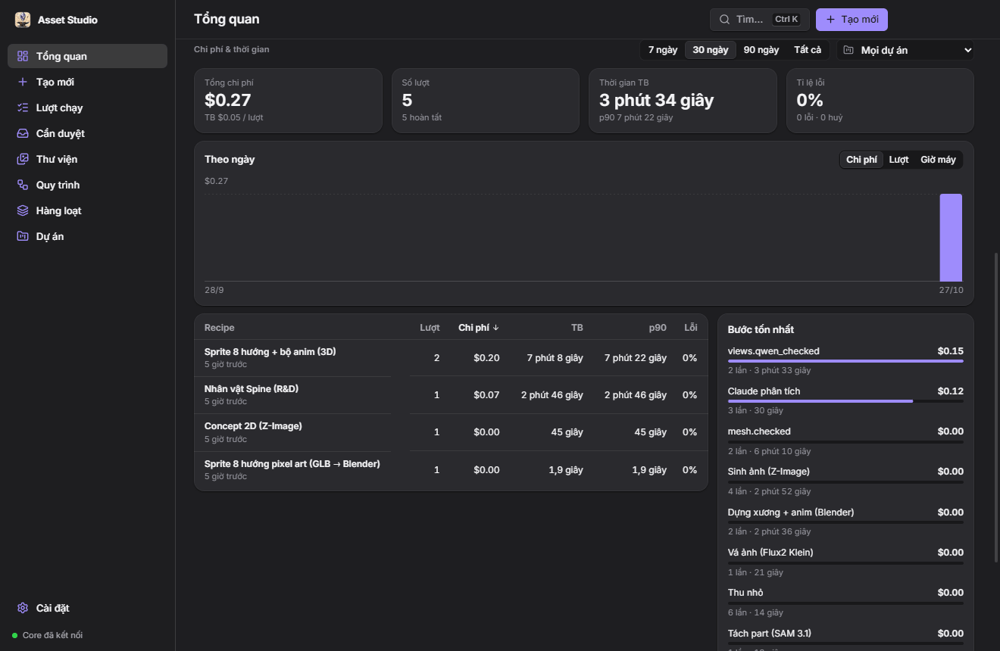
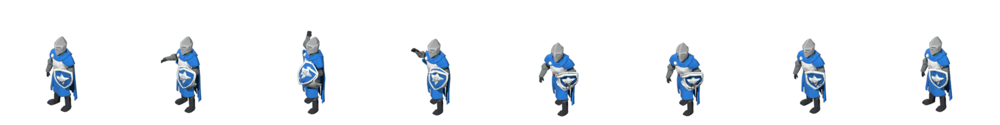
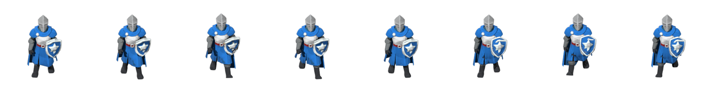
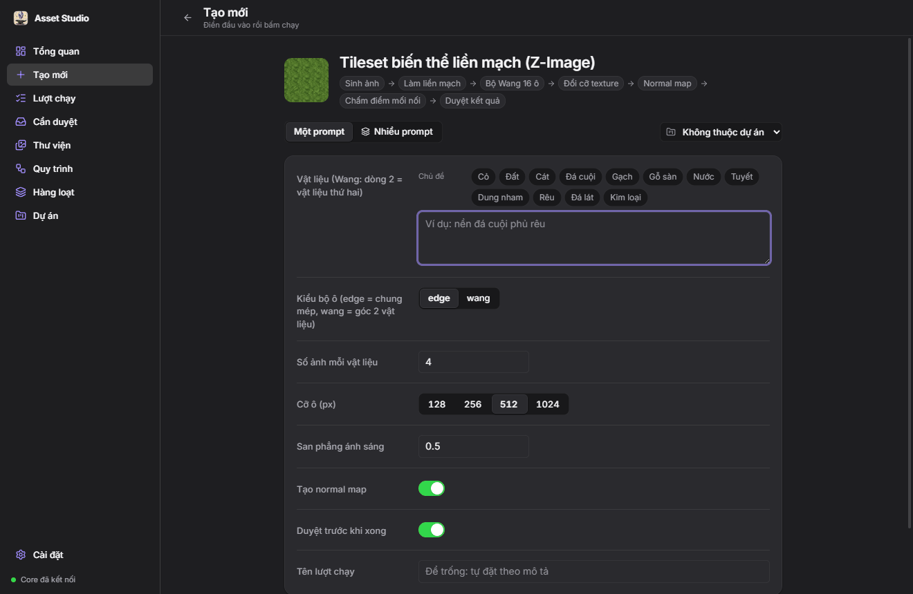
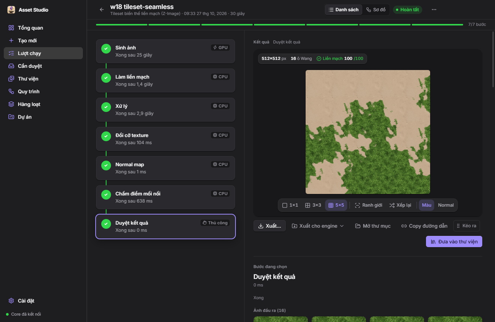
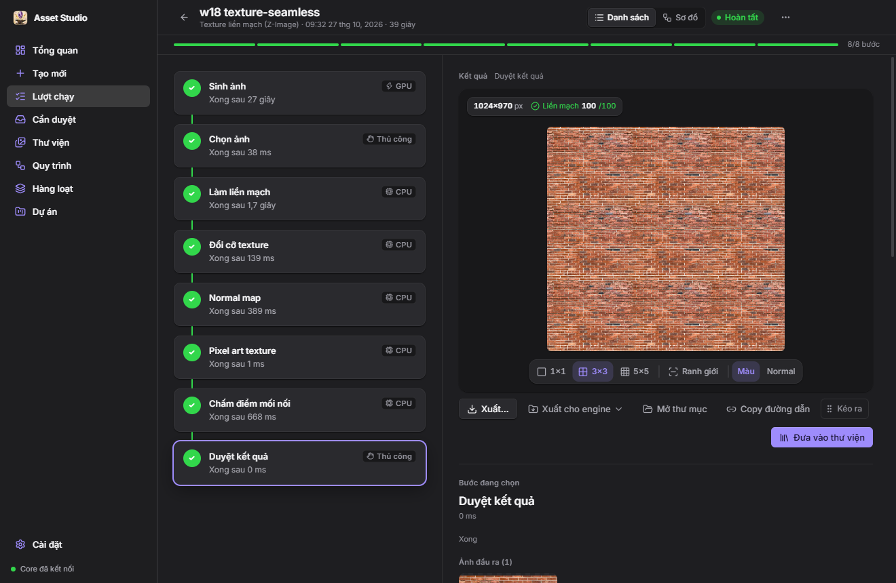
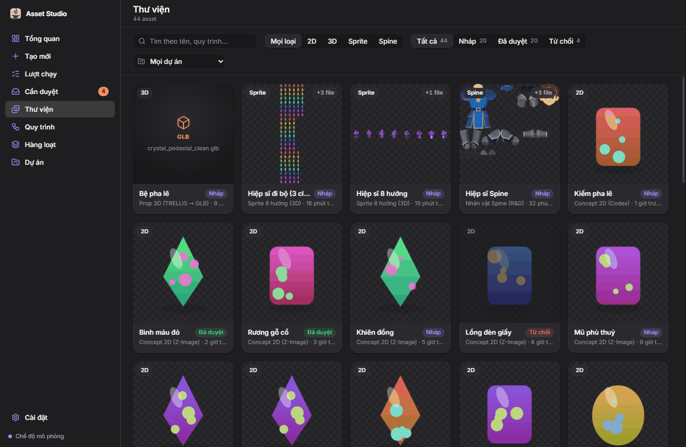
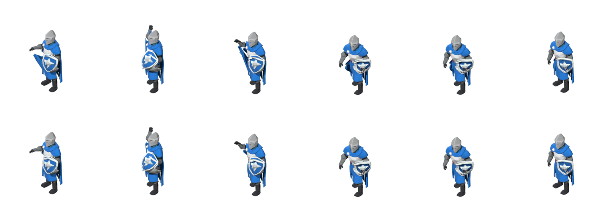

# AI Asset Studio

Ứng dụng desktop Windows để tạo asset game bằng AI, chạy hoàn toàn trên máy. App Electron + Vue (`app/`) điều khiển một
core Python (`core/`, package `studio_core`). Core chạy các **quy trình (recipe)**: chuỗi bước gọi ComfyUI (model ảnh và
mesh trên GPU), Blender (bpy headless), model cloud (Claude, Codex) và các bước duyệt tay. Kết quả xuất thẳng sang
Unity, Godot hoặc Spine. Core cũng là một MCP server, nên Claude Code / Codex điều khiển được.



## Làm được gì

| Nhóm | Recipe | Ra cái gì |
|------|--------|-----------|
| Concept 2D | `concept-2d`, `concept-2d-brief`, `concept-2d-codex`, `variants-2d` | Ảnh nền trong, biến thể, sprite sheet |
| Texture | `texture-seamless` | Texture liền mạch (tự nhận lưới gạch / ván), chấm điểm mối nối, normal map, pixel art |
| Tileset | `tileset-seamless` | Bộ ô chung mép, hoặc bộ **Wang góc 16 ô** từ 2 vật liệu (cỏ / đất…) |
| Sprite 8 hướng | `sprite-8dir-2d*`, `sprite-8dir-3d*`, `sprite-8dir-glb`, `sprite-8dir-pixel` | Sheet 8 hướng (2D nhanh, hoặc qua mesh TRELLIS + Blender), bản pixel art |
| Hoạt ảnh | `sprite-8dir-anim`, `sprite-8dir-walk` | Rig thủ tục + clip đứng / đi / chạy / đánh, 8 hướng, kèm normal |
| Spine (R&D) | `spine-character`, `spine-character-mv` | Tách part + xương, xuất Spine 4.2 |
| 3D | `prop-3d`, `procedural-3d` | GLB đã dọn + turntable; hoặc Claude viết bpy rồi tự soát |

Hiệp sĩ 8 hướng, clip tấn công (góc 45°) và đi bộ (góc 0°), render bằng Blender từ một mesh TRELLIS:




## Giao diện

**Tạo mới** — chọn recipe, điền input; chip gợi ý vật liệu, chạy một prompt hoặc nhiều prompt.



**Lượt chạy** — từng bước với lane (GPU / Blender / CPU / thủ công), thời gian, kết quả xem ngay: lát 3×3 / 5×5, ranh
giới ô, xếp lại Wang, màu / normal; xuất file hoặc xuất cho engine.




**Thư viện** — mọi asset theo loại (2D, 3D, Sprite, Spine, Texture), trạng thái nháp / đã duyệt / từ chối, theo dự án.



Các màn khác: Cần duyệt (gate chọn ảnh / duyệt kết quả), Quy trình (xem + sửa recipe YAML), Hàng loạt (nhiều prompt một
lần), Dự án (khoá style, palette pixel cho cả nhóm asset), Cài đặt (đường dẫn công cụ + kiểm tra). Phím tắt `Ctrl+1..8`,
command palette `Ctrl+K`.

## Xuất sang engine

- **Unity** (`core/studio_core/export/unity.py`): texture đã slice + `.meta`, AnimationClip, Animator blend tree 8
  hướng, prefab, `_NormalMap` secondary texture; tileset Wang thành 16 sprite.
- **Godot 4** (`export/godot.py`): `SpriteFrames.tres`, scene AnimatedSprite2D, `CanvasTexture` có normal, TileSet
  terrain Match Corners cho Wang, material texture lặp.
- **Spine**: JSON + atlas + PNG. **GLB** xuất thẳng.

## Chạy và build

Yêu cầu: Windows 10/11 x64, Node 24, [uv](https://docs.astral.sh/uv/) ≥ 0.11 (tự lấy Python 3.13), ComfyUI có sẵn
workflow, Blender 5.2. Máy chuẩn đang dùng: RTX 5070 12 GB, 64 GB RAM (recipe anim đỉnh ~28 GB RAM). Bước Claude cần
`claude` trên PATH. Đường dẫn mặc định ở `core/studio_core/config.py`, đổi trong màn **Cài đặt**.

```bash
# dev
cd app && npm install && npm run dev        # npm run dev:mock = core giả, không cần GPU
# kiểm tra
cd core && uv run pytest -q
cd app && npm run typecheck
# build bộ cài (core PyInstaller + Electron)
cd app && npm run dist                       # → app/release/<version>/AI-Asset-Studio-Setup-<version>-x64.exe
cd app && npm run dist:core && npm run dist:portable   # → app/release/<version>/win-unpacked/ (thêm file rỗng `portable` cạnh exe)
```

Chi tiết build, bản portable và chỗ lưu dữ liệu: [BUILD.md](BUILD.md). Tích hợp ComfyUI:
[COMFYUI-INTEGRATION.md](COMFYUI-INTEGRATION.md), [COMFYUI-WORKFLOWS.md](COMFYUI-WORKFLOWS.md).

## MCP (Claude Code / Codex)

`studio-core.exe mcp [--data-dir …]` mở MCP server qua stdio, nối vào core đang chạy. Lệnh đăng ký đúng máy có sẵn ở
**Tổng quan → Kết nối agent CLI**, dạng:

```bash
claude mcp add -s user asset-studio -- "<đường dẫn>/studio-core.exe" mcp
```

Tool: `list_recipes`, `describe_recipe`, `start_run`, `wait_run`, `get_run`, `resolve_gate`, `retry_step`,
`cancel_run`, `get_outputs`, `list_runs`, `list_versions`, `set_version_status`, `list_projects`, `recipe_stats`.
Lượt chạy từ MCP hiện luôn trong app.

## Ghi chú kỹ thuật

- Recipe là YAML trong `core/studio_core/recipes/`; mục `rules:` kiểm input chéo trước khi tốn GPU (vd. Wang cần 2 dòng
  vật liệu hoặc ≥ 2 ảnh).
- Skinning cho rig thủ tục (`core/studio_core/adapters/blender/skin_math.py`) đo khoảng cách theo bề mặt mesh, nên áo
  choàng sát tay không bị kéo theo khi vung tay (hàng trên: trước khi sửa, hàng dưới: sau):



- Kế hoạch và nhật ký phát triển: `.planning/` (`PROGRESS.md`, các file `HANDOFF-*`).
