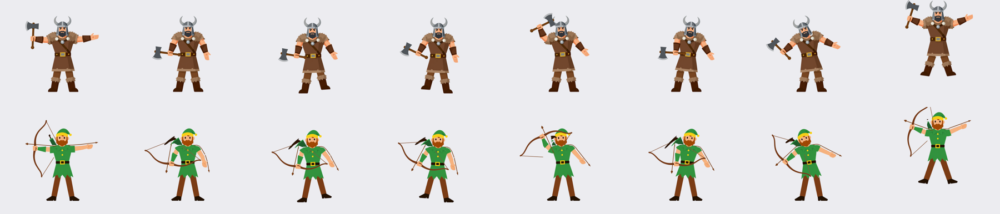
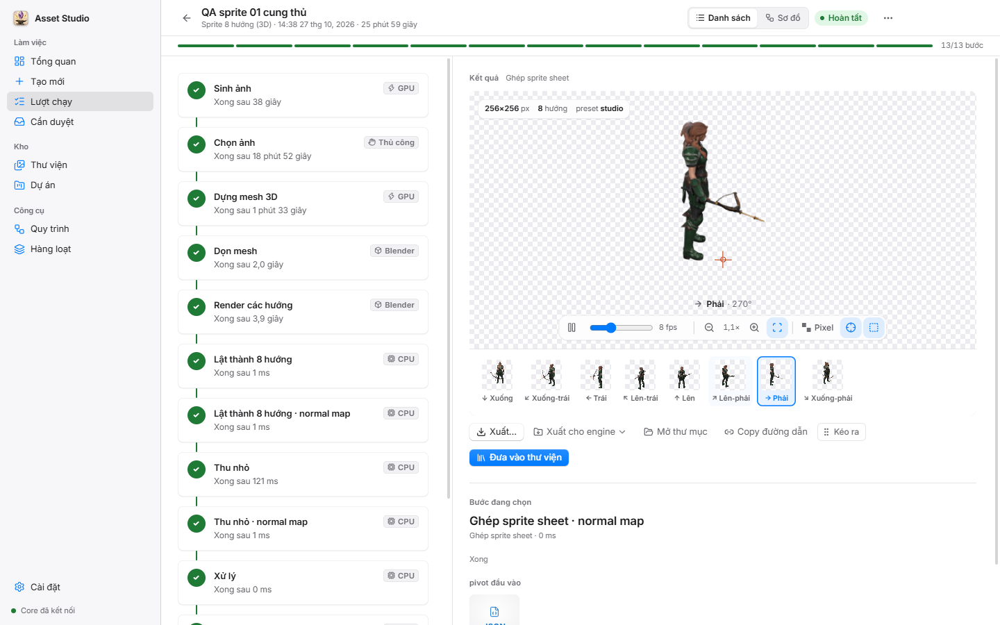
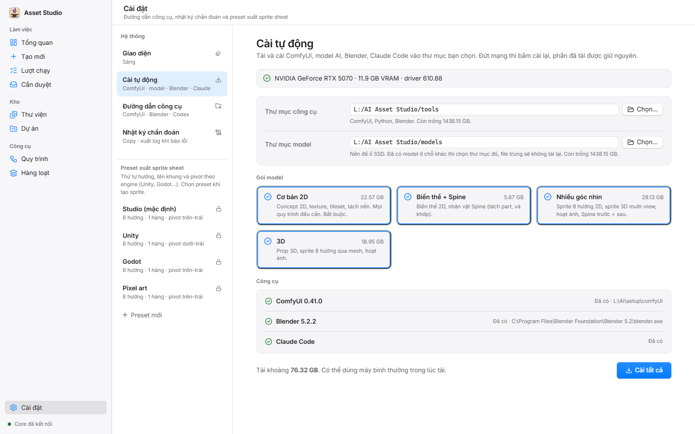
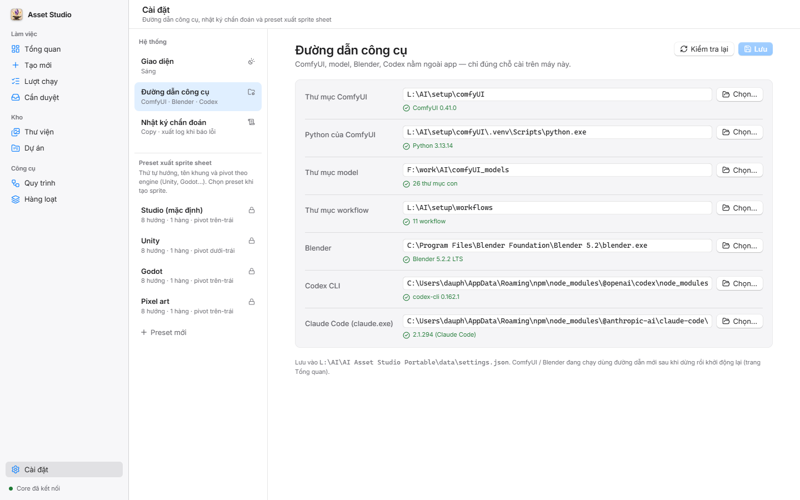

# AI Asset Studio

App Windows tạo asset game bằng AI, chạy ngay trên máy: gõ mô tả → chọn ảnh ưng → nhận sprite, texture, tileset, model 3D
hoặc nhân vật Spine có xương, xuất thẳng cho Unity / Godot / Spine.


## Tải về

Bản mới nhất: **[v1.0.0](https://github.com/doanvu2000/AI-Asset-Studio/releases/latest)** (Windows x64)

| File | Dùng khi |
|------|----------|
| `AI-Asset-Studio-Portable-1.0.0-x64.zip` | Giải nén ra đâu cũng chạy, không cần cài (khuyên dùng) |
| `AI-Asset-Studio-Setup-1.0.0-x64.exe` | Muốn cài vào máy, có shortcut Start menu / Desktop |

Tải xong → mở app → bấm **Cài tự động** (xem [Cài đặt](#cài-đặt)).

- [Tải về](#tải-về)
- [Làm được gì](#làm-được-gì)
- [Cài đặt](#cài-đặt)
- [Dùng lần đầu](#dùng-lần-đầu)
- [Lỗi hay gặp](#lỗi-hay-gặp)

## Làm được gì

| Muốn | Quy trình | Ra cái gì |
|------|-----------|-----------|
| Ảnh vật phẩm / nhân vật nền trong | **Concept 2D** (Z-Image, Codex, hoặc *ý tưởng → brief* để Claude viết prompt giúp) | PNG nền trong suốt |
| Nhiều biến thể từ ảnh có sẵn | **Biến thể 2D (Flux.2 Klein)** | Biến thể + sprite sheet |
| Texture lát liền mạch | **Texture liền mạch** | Texture + điểm mối nối, normal map, bản pixel art |
| Bộ ô nền (cỏ / đất…) | **Tileset liền mạch** | Ô chung mép, hoặc bộ Wang 16 ô từ 2 vật liệu |
| Nhân vật nhìn 8 hướng | **Sprite 8 hướng** (2D nhanh từ ảnh, hoặc 3D qua mesh: đều hơn) | Sprite sheet 8 hướng + JSON, tuỳ chọn normal map / pixel art |
| Nhân vật biết đứng / đi / chạy / đánh | **Sprite 8 hướng hoạt ảnh** | Clip 8 hướng, kèm normal |
| Nhân vật Spine có xương | **Nhân vật Spine** (hoặc *trước + sau*) | Spine 4.2: JSON + atlas + PNG, 6 animation |
| Vật thể 3D | **Prop 3D (TRELLIS)** hoặc **Procedural 3D** (Claude viết code Blender) | GLB đã dọn + ảnh xoay vòng |

Mẹo prompt: viết tiếng Anh, mô tả vật thể trước, phong cách sau. Chip gợi ý dưới ô prompt thêm sẵn chất liệu / phong
cách. Muốn cả loạt asset cùng phong cách → tạo **Dự án**, khoá style + palette pixel ở đó.

Sprite hiệp sĩ 8 hướng (đánh 45°, đi 0°) dựng qua mesh 3D:


Nhân vật Spine tự tách part + gắn xương; vũ khí cầm tay đi theo bàn tay:


### Một lượt chạy

Mỗi lượt chạy là một chuỗi bước, mỗi bước ghi rõ chạy ở đâu (GPU / Blender / CPU / Cloud / Thủ công) và mất bao lâu.
Kết quả hiện ngay bên phải: xoay hướng, đổi tốc độ, phóng to, bật lưới pixel.



- **Bước "Thủ công"** (chọn ảnh, duyệt kết quả) dừng chờ bạn. Mọi bước đang chờ gom ở **Cần duyệt**.
- Bước lỗi → bấm **Thử lại** trên bước đó, không phải chạy lại từ đầu.
- **Xuất cho engine**: Unity (sprite đã cắt, animation 8 hướng, prefab), Godot 4 (SpriteFrames, scene, TileSet),
  Spine (JSON + atlas + PNG), GLB.

Texture và tileset có chế độ xem lát 3×3 / 5×5 để soi mối nối:


**Thư viện** giữ mọi asset theo loại, lọc nháp / đã duyệt / từ chối, theo dự án:


Màn khác: **Hàng loạt** (nhiều prompt một lần), **Quy trình** (xem + chỉnh các bước), **Dự án**. Phím tắt `Ctrl+1..8`
đổi màn, `Ctrl+K` tìm mọi thứ.

## Cài đặt

### 1. Máy cần có

- Windows 10/11 x64, GPU NVIDIA ≥ 12 GB VRAM, driver NVIDIA ≥ 580. Máy chuẩn: RTX 5070 12 GB, 64 GB RAM.
- Ổ trống khoảng 100 GB (model AI ~77 GB nếu lấy đủ các gói, công cụ ~13 GB; nên để ổ SSD).
- Mạng internet cho lần cài đầu. Tài khoản Claude nếu muốn dùng các bước Claude viết brief / soát khớp xương.

### 2. Mở app

- **Bản portable** (khuyên dùng): giải nén `AI-Asset-Studio-Portable-1.0.0-x64.zip` ra đâu cũng được (vd. `D:\`), chạy
  `AI Asset Studio Portable\AI Asset Studio.exe`.
  Dữ liệu nằm ngay trong thư mục đó (`data\`), mang sang máy khác vẫn còn.
- **Bản cài**: chạy `AI-Asset-Studio-Setup-1.0.0-x64.exe`. Dữ liệu ở `%APPDATA%\AI Asset Studio\data`.

SmartScreen báo "Windows protected your PC" → **More info → Run anyway** (app chưa ký số).

### 3. Bấm "Cài tự động"

Lần đầu mở app, thẻ **Bắt đầu** ở Tổng quan có nút **Cài tự động** (hoặc vào **Cài đặt → Cài tự động**):

1. Chọn thư mục công cụ và thư mục model (máy đã có model ở đâu thì chọn đúng chỗ đó, file trùng không tải lại).
2. Chọn gói model cần dùng. Gói **Cơ bản 2D** bắt buộc; các gói khác bật theo loại asset muốn làm.
3. Bấm **Cài tất cả**, chờ tải xong. App tự cài ComfyUI + Python + PyTorch, tải model, Blender, Claude Code rồi tự
   điền đường dẫn.
4. Bấm **Đăng nhập Claude**, làm theo hướng dẫn trong cửa sổ hiện ra (chỉ cần một lần).



| Gói model | Dung lượng | Dùng cho |
|-----------|-----------:|----------|
| Cơ bản 2D (bắt buộc) | 22.6 GB | Concept 2D, texture, tileset, tách nền |
| Biến thể + Spine | 5.7 GB | Biến thể 2D, nhân vật Spine |
| Nhiều góc nhìn | 29.1 GB | Sprite 8 hướng 2D, sprite 3D multi-view, hoạt ảnh, Spine trước + sau |
| 3D | 19 GB | Prop 3D, sprite 8 hướng qua mesh, hoạt ảnh |

Mạng 100 Mbps tải đủ các gói mất khoảng 2 giờ. Đứt mạng / tắt máy giữa chừng thì mở lại và bấm **Cài tiếp**, phần đã
tải được giữ nguyên. Mỗi file tải xong đều được kiểm mã sha256.

Codex CLI không cài tự động (chỉ dùng cho `Concept 2D (Codex)`, tuỳ chọn).

<details>
<summary>Đã có ComfyUI sẵn / muốn tự cài tay</summary>

Vào **Cài đặt → Đường dẫn công cụ**, bấm **Chọn…** từng dòng, **Kiểm tra lại** đến khi tất cả có dấu ✓ xanh, **Lưu**.



Cài ComfyUI tay (cần [git](https://git-scm.com/download/win) và [uv](https://docs.astral.sh/uv/getting-started/installation/)):

```powershell
git clone --branch v0.41.0 https://github.com/comfy-org/ComfyUI D:\AI\comfyUI
cd D:\AI\comfyUI
uv venv --python 3.13 .venv
uv pip install --python .venv torch==2.14.1 torchvision==0.29.1 torchaudio==2.11.0 --index-url https://download.pytorch.org/whl/cu130
uv pip install --python .venv -r requirements.txt
```

Tải model tay: `powershell -ExecutionPolicy Bypass -File setup\comfyui-models.ps1 -Root E:\AI\comfyUI_models`.

</details>

App tự bật ComfyUI / Blender khi lượt chạy cần và tắt khi đóng app. Thanh trên cùng của **Tổng quan** cho biết trạng
thái từng công cụ.

## Dùng lần đầu

1. Bấm **Tạo mới** (`Ctrl+N` hoặc nút xanh góc phải).
2. Chọn một quy trình, ví dụ **Concept 2D (Z-Image)**.
3. Gõ prompt tiếng Anh, vd. `crystal sword with a dragon hilt, game item`, bấm **Bắt đầu chạy**.
4. Khi app sinh xong vài ảnh, mục **Cần duyệt** sáng lên → bấm chọn ảnh ưng nhất.
5. Lượt chạy làm nốt (tách nền, căn chỉnh) → bấm **Đưa vào thư viện** hoặc **Xuất… / Xuất cho engine**.


## Lỗi hay gặp

| Triệu chứng | Cách xử lý |
|-------------|------------|
| Dòng ComfyUI / Blender có dấu đỏ | **Cài đặt → Cài tự động** → **Cài tất cả** (chỉ cài phần thiếu), hoặc sửa tay ở **Đường dẫn công cụ** |
| Cài tự động báo lỗi driver | Cập nhật driver NVIDIA (≥ 580) rồi bấm **Cài tiếp** |
| Bước Claude lỗi | **Cài đặt → Cài tự động → Đăng nhập Claude**, rồi **Thử lại** bước đó |
| Lần mở đầu báo core chưa sẵn sàng sau 60 giây | Defender đang quét; mở lại app hoặc thêm thư mục app vào exclusion |
| GPU hết bộ nhớ / ComfyUI tắt giữa chừng | Đóng app nặng khác (game, trình duyệt nhiều tab), chạy từng lượt một |
| Cần gửi log báo lỗi | **Cài đặt → Nhật ký chẩn đoán → Copy** |

Tự build từ mã nguồn: [BUILD.md](BUILD.md).
